 

## About

I sit between **marketing** and **engineering**. At EY Academy of Business I work with campaigns, leads and analytics — and instead of exporting another spreadsheet, I write the script, bot or dashboard that does it for me.

- **Marketing:** analytics, reporting, lead funnels, event activation
- **Data:** Python, ML scoring, Explainable AI, Streamlit dashboards
- **Product:** React / Next.js / TypeScript, Django & FastAPI backends
- **Automation:** Telegram & Discord bots, GPT assistants, CRM workflows

## How I work

| 1 · Acquire | 2 · Measure | 3 · Automate | 4 · Decide |
| :---: | :---: | :---: | :---: |
| Campaigns, events, landing pages | Funnels, cohorts, attribution | Bots, CRM flows, reminders | Scoring, dashboards, XAI |

## Projects

| Project | What it does | Stack |
| :-- | :-- | :-- |
| [**streamlit_air_quality_mvp**](https://github.com/Nerdlin/streamlit_air_quality_mvp) | Air-quality monitoring MVP for Kazakhstan: machine learning, Explainable AI, satellite data |   |
| [**pet_project_earthquake**](https://github.com/Nerdlin/pet_project_earthquake) | End-to-end data-engineering pipeline (fork): USGS Earthquake API → MinIO → PostgreSQL → Metabase, orchestrated with Airflow |    |
| [**AIO**](https://github.com/Nerdlin/AIO) | "All In One" platform joining APIs, messengers and ERP/CRM systems into one AI-driven flow |  |
| [**Campus_Hub**](https://github.com/Nerdlin/Campus_Hub) | Modern educational platform |  |
| [**Aria_to-do-list**](https://github.com/Nerdlin/Aria_to-do-list) | Productivity app with AI hints and statistics, soft neumorphic UI |   |
| [**blockerino**](https://github.com/Nerdlin/blockerino) | Pixel block puzzle: 8×8 classic, 10×10 chaos, 1v1 duels, mini-games, seasonal ratings |  |

## Tech stack

 

 

 

## GitHub activity

  

